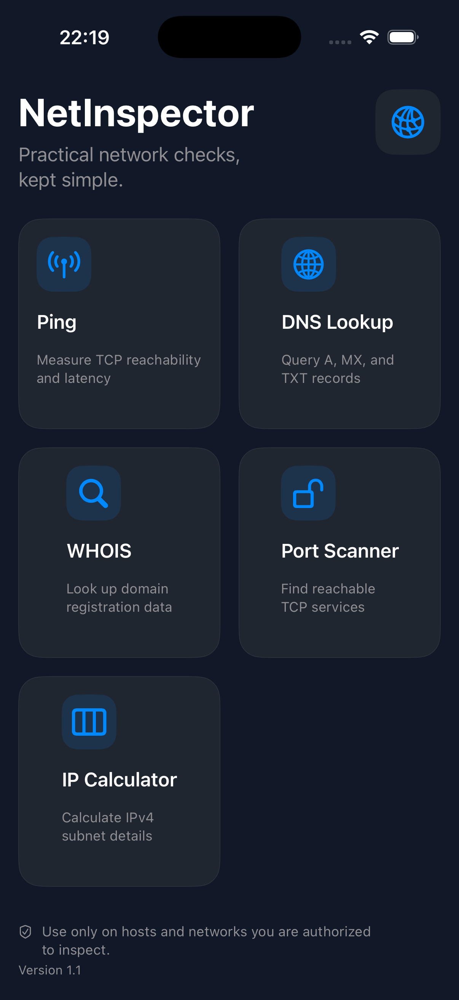

# NetInspector

**A focused iOS toolkit for everyday network checks.**

NetInspector gives developers, students, and IT professionals a clean way to check TCP reachability, inspect DNS records, look up domain registration data, scan approved TCP port ranges, and calculate IPv4 subnet details from one native SwiftUI app.

> Only inspect systems and networks you own or are explicitly authorized to test.

## Screenshots

  

## Features

- **TCP latency check** — measures connection latency to a host over TCP/443 and presents individual samples plus minimum, average, and maximum times.
- **DNS lookup** — looks up `A`, `MX`, and `TXT` records through Google Public DNS.
- **RDAP / WHOIS lookup** — displays domain name, lifecycle events, and name servers from the RDAP service.
- **TCP port scanner** — checks a user-provided range, shows progress, identifies common services, and retains unknown open ports in the result list.
- **IPv4 subnet calculator** — calculates network, broadcast, usable host range, and host count; validates that subnet masks are contiguous and handles `/31` and `/32` correctly.

## Built with

- Swift 6
- SwiftUI and Observation
- Apple's Network framework
- URLSession
- Xcode 26+

## Getting started

1. Clone the repository.
2. Open `NetInspector.xcodeproj` in Xcode.
3. Choose an iOS Simulator or a connected device.
4. Build and run the **NetInspector** scheme.

The app has no third-party package dependencies.

## Notes on network tools

- The Ping tool is a **TCP reachability/latency** measurement, not an ICMP echo request. It uses port `443`, so a host that blocks HTTPS may appear unreachable.
- Port scans are deliberately capped at **1,024 ports per run** to keep the mobile experience responsive and to encourage scoped, authorized checks.
- DNS results come from Google Public DNS; RDAP data is requested from `rdap.org`. An internet connection is required for these tools.

## Privacy

NetInspector does not include analytics, advertising SDKs, or third-party tracking libraries. Queries are sent only to the target host or the public endpoint required by the selected tool.

## Roadmap

- [ ] Traceroute
- [ ] Copy/share individual results
- [ ] Exportable inspection report
- [ ] Additional DNS record types

## Contributing

Issues and pull requests are welcome. Please keep changes focused, add or update tests for calculation logic, and only propose scanning features that preserve the app's authorization-first approach.

## License

No license has been selected yet. Before accepting outside contributions or distributing the project, add a license appropriate for your intended use.
